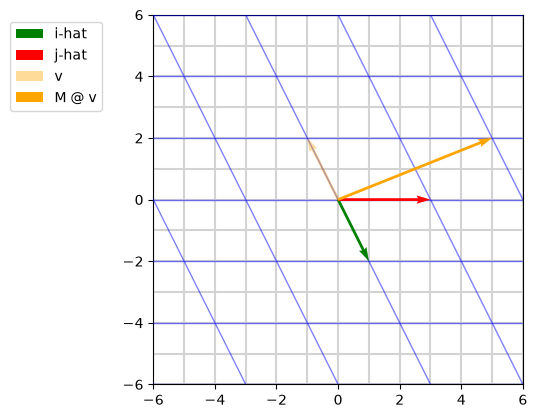

# 01-grid-warp: linear transformations



## Linear transformations

A linear transformation is a function: it takes a vector in and gives a vector out. It moves every point in space, and the grid is a way to watch a lot of points move at once.

### What a vector's coordinates mean

Coordinates are a recipe. i-hat is the arrow (1, 0), one step right, and j-hat is the arrow (0, 1), one step up. The vector v = (-1, 2) means: take i-hat -1 times, take j-hat 2 times, and add them. You end up 1 step left and 2 steps up.

### What a transformation changes

A transformation changes the basic steps. In the lesson's example, i-hat lands on (1, -2) and j-hat lands on (3, 0). These two new positions are the transformation itself. Written as columns, they are the matrix:

```
M = [ 1  3 ]
    [-2  0 ]
```

The coordinates of v stay the same. (-1, 2) is still the recipe "-1 times i-hat plus 2 times j-hat". The arrows in that recipe have moved, so v lands somewhere new:

```
-1 × (1, -2) + 2 × (3, 0) = (-1, 2) + (6, 0) = (5, 2)
```

Every vector is built from i-hat and j-hat, so knowing where those two land tells you where every vector lands.

### What M @ v computes

`M @ v` follows v's recipe with the new arrows. It multiplies each column of M by the matching coordinate of v and adds the results.

```python
M = np.array([[1, 3], [-2, 0]])
v = np.array([-1, 2])
print(M @ v)  # [5 2]
```

### Why move every point instead of one vector?

A transformation is a rule, like a function in code, and a function is written to work for any input. Real programs use it the same way:

- rotating a photo applies the same rule to every pixel
- a 3D game moves every corner of every object each frame
- a neural network layer applies its weight matrix to every input it receives

### Where the matrix comes from

The transformation is whatever matrix you are working with, so it is always written down somewhere. In graphics, the programmer picks it ("rotate by 30 degrees"). In a neural network, training finds it: the weight matrix starts random, and learning adjusts it until the transformation is useful.

## How the code works

### Why transforming two endpoints is enough

A linear transformation keeps straight lines straight. To find where a grid line goes, I move its two ends with M and draw a new line between them. `plot` takes the x values first and the y values second.

```python
p1 = np.array([x, -5])
p2 = np.array([x, 5])
q1 = M @ p1
q2 = M @ p2
ax.plot([q1[0], q2[0]], [q1[1], q2[1]], color="blue")
```

### What angles, scale_units and scale do in quiver

`quiver` was made for drawing many small arrows, such as wind maps, so by default it resizes arrows to look tidy. These three settings turn that off and draw each arrow at its true size on the grid:

- `angles="xy"`: the arrow points from (x, y) to (x + dx, y + dy) in grid coordinates
- `scale_units="xy"`: length is measured in grid units
- `scale=1`: no shrinking, because the drawn length is the vector's length divided by `scale`

### What zorder does

`zorder` decides which drawing sits on top. Higher numbers are drawn later and cover lower ones. Lines from `plot` sit at 2 by default. In this plot the transformed grid uses 3, the i-hat and j-hat arrows use 4, and v uses 5, so the arrows are never hidden under the blue lines.