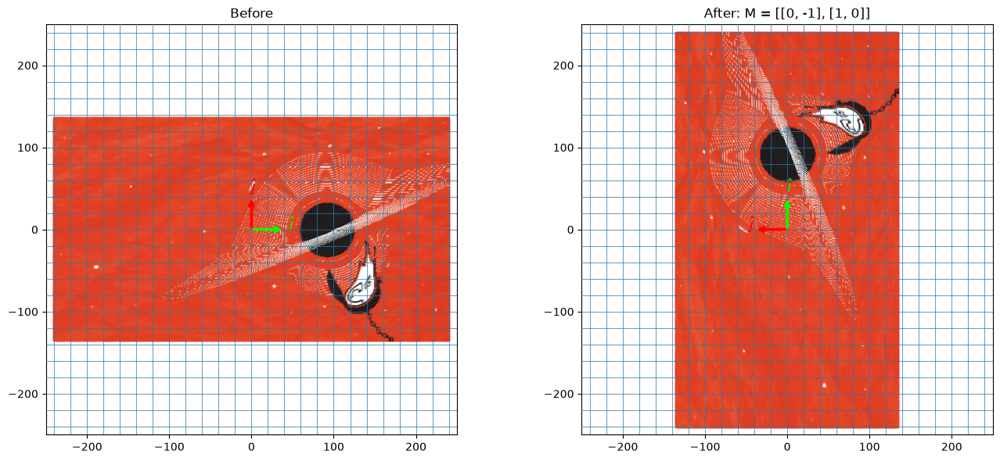
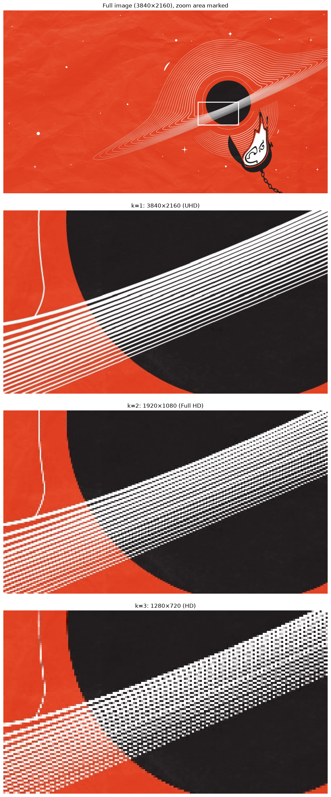

# 02-image-transform: images as points



## An image is a set of points

In 01 I moved the points of a grid. An image is also a grid: every pixel has a row, a column and a color. If I draw each pixel as a dot at its (x, y) position, the photo becomes a set of vectors, and one matrix can move all of them. Each dot keeps its color and only its position changes. Drawing pixels as dots is a simplification, but it makes it easy to see where every one of them goes.

### What the matrix does to i-hat and j-hat

The matrix gives i-hat and j-hat new positions. Its columns are where they land:

```
M = [ 0  -1 ]
    [ 1   0 ]
```

i-hat (1, 0) lands on (0, 1), so "right" becomes "up". j-hat (0, 1) lands on (-1, 0), so "up" becomes "left". That is a 90° turn counterclockwise.

The pixel's coordinates are the scalars, and they stay the same. A pixel at (3, 2) is still "3 times i-hat plus 2 times j-hat", only the arrows have moved:

```
3 × (0, 1) + 2 × (-1, 0) = (0, 3) + (-2, 0) = (-2, 3)
```

### Why I center the image first

A linear transformation never moves the origin, and a rotation turns around it. In the array, (0, 0) is the top-left pixel, so the photo would swing around its corner. Subtracting w/2 and h/2 puts the middle of the picture at (0, 0), so it spins in place.

### Rows go down, y goes up

Columns grow to the right, the same direction as x, so centering them is enough. Row numbers grow downward, but y grows upward, so the sign has to flip as well:

```python
xs = cols.ravel() - w / 2
ys = h / 2 - rows.ravel()
```

Row 0, the top of the image, gets the largest y, so the top of the picture stays at the top of the plot.

### How a phone rotates a photo

Photo apps use the same kind of matrix but run it backwards. If you push each pixel forward with M at an angle like 30°, the dots land between grid spots and leave holes and overlaps. So the app starts from the result: for each output pixel, it uses the inverse matrix (rotate the other way) to find where that pixel came from in the original, then copies or blends that color.

A plain 90° turn needs no blending, because pixels just change places. Phones often don't change the pixels at all and only save a note that says "show this rotated".

## How the code works

### Shrinking the image with `[::k, ::k]`

`img[::k, ::k]` keeps every k-th row and every k-th column. The photo is 3840×2160, about 8.3 million pixels, and plotting that many dots with `scatter` is very slow. With k = 8 it becomes 480×270, about 130,000 dots, which is still enough to see the photo.

### By the way, this is how image resolution works



Different k values give the standard screen resolutions:

| k | size | name | pixels kept |
|---|------|------|-------------|
| 1 | 3840×2160 | UHD (4K) | all, about 8.3 million |
| 2 | 1920×1080 | Full HD | 1/4 |
| 3 | 1280×720 | HD | 1/9 |
| 8 | 480×270 | used in image_transform.py | 1/64 |

Each side shrinks by k, so the pixel count shrinks by k × k. Fewer pixels means each pixel covers a bigger piece of the scene, so small details disappear. `resolution_comparison.py` shows this: the zoom panels show the same small area at each k, and the squares get bigger as k grows.

How sharp a screen looks also depends on its size. The same 1920×1080 looks sharper on a phone than on a TV, because the pixels are packed tighter (more pixels per inch).

Shrinking is a linear transformation too. The pixel at (i, j) in the small image came from (k·i, k·j) in the big one, so going from old coordinates to new ones divides both by k:

```
S = [ 1/k   0  ]
    [  0   1/k ]
```

S shrinks i-hat and j-hat to 1/k of their length. Unlike the rotation, most pixels land between whole-number spots, and `[::k, ::k]` throws those away. Real resize tools average the neighbors instead, which looks smoother.

### np.indices

`rows, cols = np.indices((h, w))` gives two grids of shape h×w, one with each pixel's row number and one with its column number.

### Points and colors in the same order

`ravel()` flattens the grids, and `reshape(-1, 3)` flattens the image into one RGB row per pixel. Both go through the pixels in the same order, left to right and top to bottom, so the n-th point and the n-th color belong to the same pixel.

### One `@` moves every pixel

`np.vstack([xs, ys])` builds a 2×N array where each column is one pixel's (x, y). `M @ points` multiplies M by every column at once. It is the same `M @ v` as in 01, done for N vectors.

### Colors

A JPG loads as whole numbers from 0 to 255 (`uint8`). `scatter` wants colors between 0 and 1, so I divide by 255. A PNG already loads as 0 to 1 and would not need this.

### Grid and arrows

`draw_grid` and `draw_basis` work like in 01. I move each grid line by transforming only its two endpoints, and the i-hat and j-hat arrows are the columns of the matrix, drawn 40 times longer so they are visible. The "Before" panel uses the identity matrix `np.eye(2)`, which leaves everything where it is. The grid lines are 3 × lim long so a shear doesn't leave empty corners.

### Plot settings

- `marker="s"` draws each pixel as a small square.
- `set_aspect("equal")` makes one unit on x as long as one unit on y. Without it, a rotated photo would look stretched.
- `lim` is the largest coordinate before or after the move, plus a margin, so both pictures fit for any M.
- `zorder`: the photo sits at 2, the grid at 3 on top of it, and the arrows at 4 on top of everything.

### resolution_comparison.py

- The first panel shows the whole photo with a white `Rectangle` around the zoom area.
- Each other panel takes the same crop with `crop[::k, ::k]`. `interpolation="nearest"` draws every pixel as a sharp square. Without it, matplotlib can smooth the pixels and hide the blockiness.
- The title uses `img[::k, ::k].shape` to show the size of the whole image at that k, not just the crop.
- `top` (1080) and `left` (2304) are divisible by 1, 2 and 3. That keeps the crop on the same every-k-th grid as the full image, so the zoom shows exactly the pixels the smaller image keeps.
